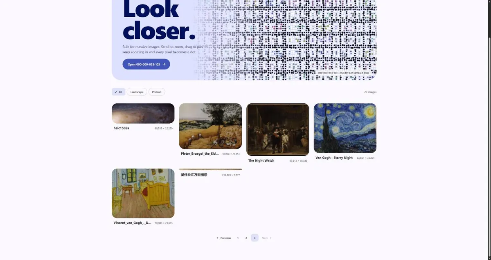
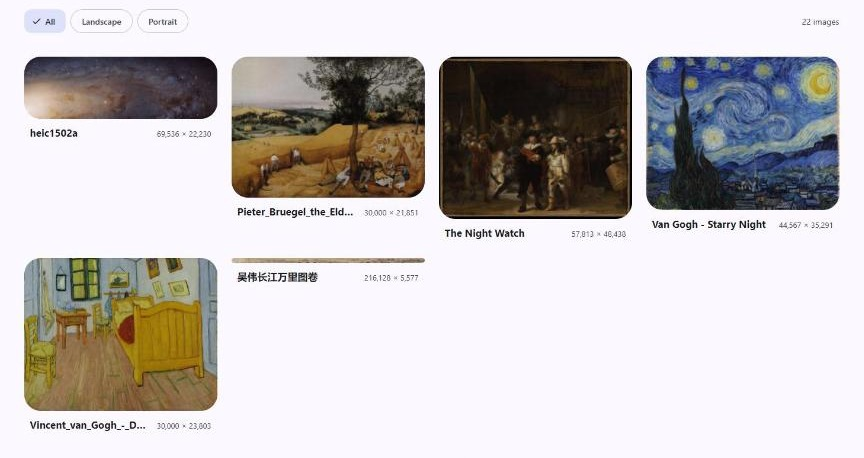
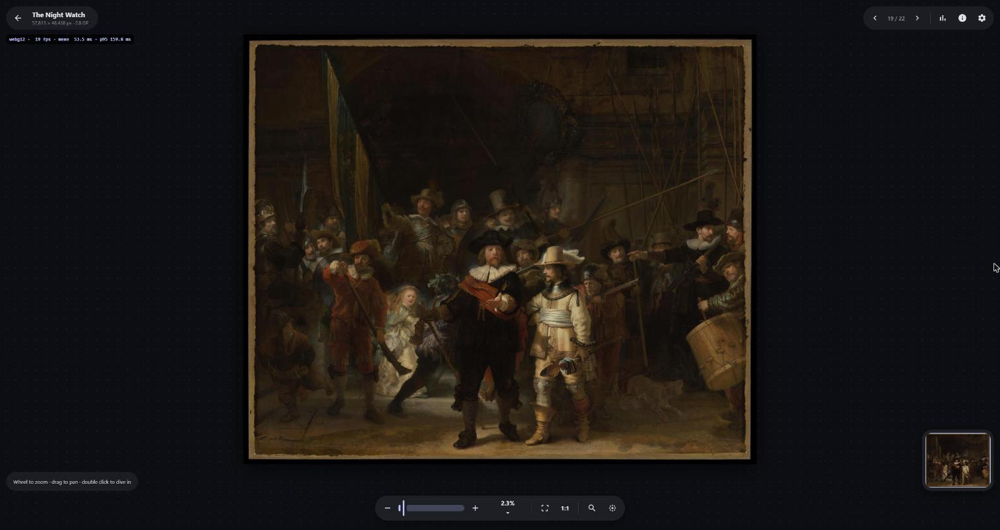
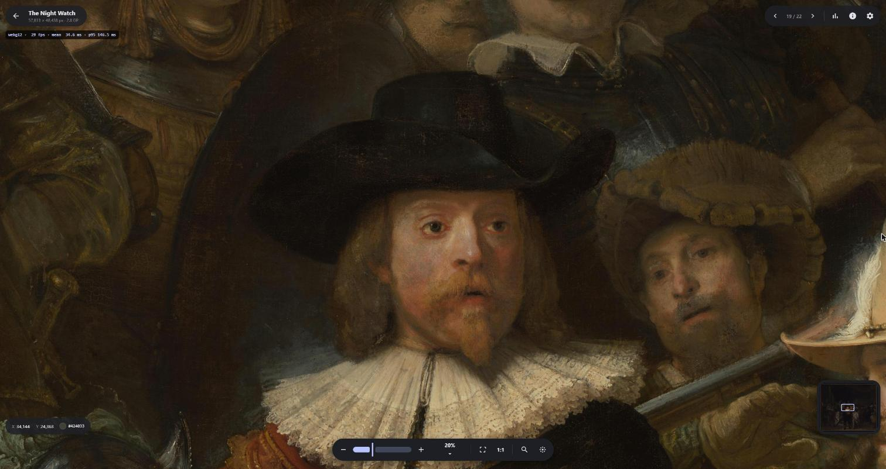
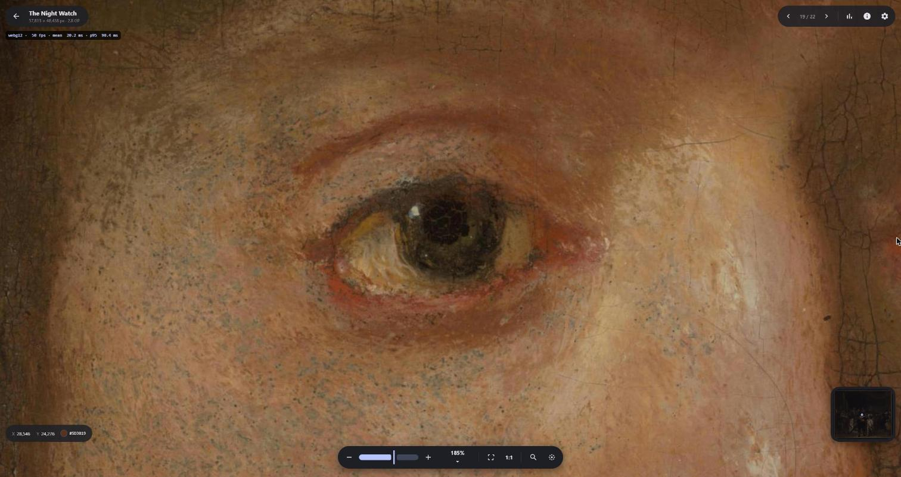
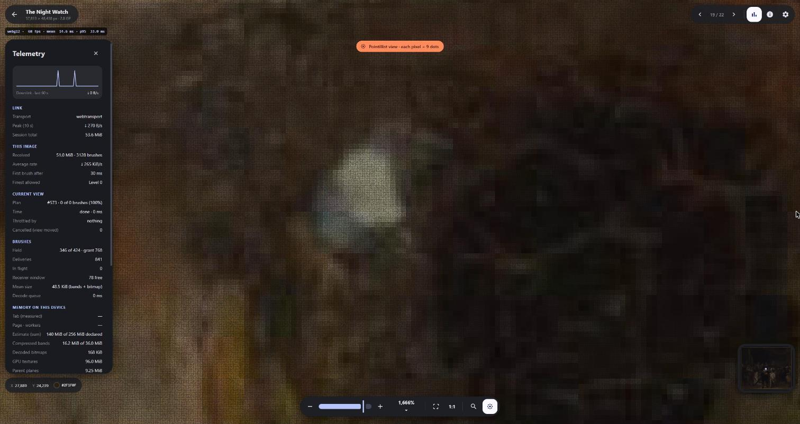
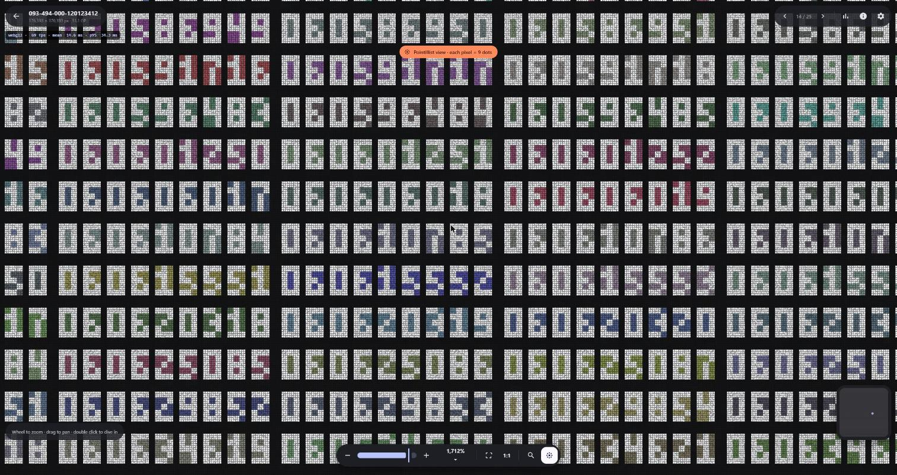
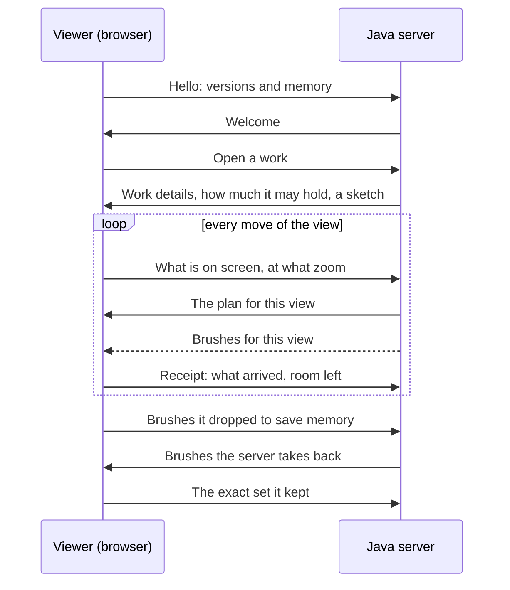

<h1 align="center">Seurat/1</h1>

<p align="center">
  <strong>Gigapixel images, streamed as brush strokes.</strong><br>
  An asynchronous Java 21 server and a browser viewer that speak their own protocol.<br>
  The image never travels whole: the server decides, view by view, which detail to paint and which to take back.
</p>

<p align="center">
  
</p>

<p align="center">
  <sub><em>The Night Watch</em>, 57,813 × 48,438 px (2.8 gigapixels): from the whole canvas to one eye, then to single pixels drawn as dots, and back.</sub>
</p>

<p align="center">
  <a href="#quick-start">Quick start</a> ·
  <a href="#what-makes-it-different">What makes it different</a> ·
  <a href="#screenshots">Screenshots</a> ·
  <a href="#how-it-works">How it works</a> ·
  <a href="docs/Seurat%20protocol-3.md">Protocol spec</a>
</p>

---

## What makes it different

- **The image never travels whole.** When an image is added, the server cuts it into small pieces, called brushes, at several levels of detail. As you look around, the viewer tells the server what is on screen, and the server sends only the detail that view still lacks. The original file never leaves the server.
- **Detail comes and goes.** The server decides how much each viewer may hold, and can take detail back. The viewer drops what it is least likely to need next, predicted from how you move and where you linger, so the browser never fills up with the whole image.
- **Nothing drifts.** The server and the viewer keep exact, matching accounts of what the viewer holds. A mismatch ends the session instead of going unnoticed.
- **Two transports, one port.** WebTransport (HTTP/3) on secure pages, WebSocket otherwise. The same port answers http and https, with a certificate generated at boot.
- **Built for size.** Tested from 104 × 104 px up to 176,393 × 176,393 px (31 gigapixels). Add PNG, JPEG, TIFF and Photoshop (PSB/PSD) files, or zip archives of them, by upload, by link or from a folder on the server.
- **Fully offline.** No CDN and no external request: the Java server hosts the viewer and every library it uses.

---

## Screenshots

<table>
  <tr>
    <td width="50%" valign="top">
      
      <br><sub><b>Gallery.</b> Every work on the server with its size. <i>Add</i> uploads a file, imports a link or takes a path on the server machine.</sub>
    </td>
    <td width="50%" valign="top">
      
      <br><sub><b>Fit to screen, 2.3 %.</b> The whole painting from its coarsest levels of detail. The minimap stays in the corner.</sub>
    </td>
  </tr>
  <tr>
    <td valign="top">
      
      <br><sub><b>20 %.</b> Captain Frans Banninck Cocq. Each step in fetches only the detail this view lacks.</sub>
    </td>
    <td valign="top">
      
      <br><sub><b>185 %.</b> Past 1:1 the cracks in the paint show.</sub>
    </td>
  </tr>
  <tr>
    <td valign="top">
      
      <br><sub><b>1,666 %, pointillist view.</b> Each source pixel is drawn as 9 dots. The telemetry panel shows the transport, how many brushes the browser holds against its limit, and memory use.</sub>
    </td>
    <td valign="top">
      
      <br><sub><b>31 gigapixels.</b> A 176,393 × 176,393 px numbered test grid at 1,712 %.</sub>
    </td>
  </tr>
</table>

---

## How it works



The viewer only says where it is looking. Everything else is the server's call: what to send, in what order, how fast, and what the viewer may keep. All image data leaves the server through a single component, which records each delivery before sending it and holds every viewer to its own rate cap. Zooming back out shows the image at once, because the sketch is never dropped; the server then refills only the detail the viewer no longer holds.

The protocol itself (messages, wire format and test vectors) is specified in [`docs/Seurat protocol-3.md`](docs/Seurat%20protocol-3.md), and the design decisions behind it are the ADRs in [`docs/`](docs/).

---

## Quick start

### Prerequisites

- **Java 21.** Java 20 also works; the run scripts turn on its preview features.
- **Node.js 20+ and pnpm** (or npm) to build the viewer.

### 1. Start the server

From the repository root:

```bash
bash run.sh        # Linux, macOS, WSL
```

```powershell
./run.ps1          # Windows PowerShell
```

The script builds the viewer, compiles the server with plain `javac` and starts it on port `8180`. Nothing is downloaded: the few Java libraries it needs ship in `server/vendor/`.

### 2. Open the viewer

Go to **http://localhost:8180/**, pick an image from the gallery and scroll to zoom. Every viewer gets full quality: there are no accounts and no limits on detail.

### 3. Open it from other machines

The same port answers both `http://` and `https://` with nothing to configure; the server makes its own certificate when it starts.

- **On the server machine**, `http://localhost:8180/` uses WebTransport with no warning, because browsers trust `localhost`.
- **From another machine**, `http://<address>:8180/` works right away over WebSocket. For WebTransport, open `https://<address>:8180/` instead. The certificate is self-signed, so the browser warns once (*Advanced*, then *Proceed*); without internet, no public authority can issue a certificate for a local address, so that click can't be avoided.

To use your own certificate, put a PKCS#12 keystore next to `seurat.conf` and set `tls.keystore` and `tls.password`.

---

## Adding images

The server takes PNG, JPEG, TIFF (including BigTIFF) and Photoshop (PSB/PSD) files, and `.zip` archives of them. Anyone who can open the viewer can add, rename and delete images.

### From the gallery

Click **Add** at the top right:

- **Upload file**: send an image or a `.zip` from your computer.
- **From link**: paste an `http://` or `https://` address and the server downloads it.
- **From this computer** (only when you browse from the server machine): give the full path of a file already on its disk. On the same drive this is instant, because the server links the file instead of copying it; the original stays where it is.

A dialog follows the upload and the processing, and offers **Open** when the image is ready. Until then its gallery card reads *Receiving* or *Processing N%*.

### From the inbox folder

Copy files into `.seurat/runtime/inbox/` and the server picks them up on its own:

```bash
cp /path/to/my-image.png .seurat/runtime/inbox/mona-lisa.png
cp /path/to/archive.zip  .seurat/runtime/inbox/
```

The server unpacks archives, moves each original to `.seurat/runtime/obras/<id>/master/`, builds its levels of detail and adds it to the gallery. If the server stops halfway, it starts that image over on the next run. Uploads land in a temporary file first, so the server never reads a half-sent image.

PNG, baseline JPEG, 8-bit TIFF and 8-bit Photoshop files go through fast streaming readers written for this project; anything else goes through Java's ImageIO. Embedded colour profiles are ignored. The benchmarks behind these choices are in [`docs/adr-03-ingest-decoders.md`](docs/adr-03-ingest-decoders.md).

### Over HTTP

Upload a file (its name, without the extension, becomes the image's id):

```bash
curl -X PUT --data-binary @/path/to/my-image.png \
  http://localhost:8180/seurat/v1/obras/mona-lisa.png
```

Import from a link, or from a path on the server:

```bash
curl -X POST -H "Content-Type: text/plain" \
  -d "https://example.org/mona-lisa.tif" \
  http://localhost:8180/seurat/v1/importar
```

Rename an image (only the name shown changes; the edit button on its gallery card does the same):

```bash
curl -X PATCH -H "Content-Type: text/plain" -d "Mona Lisa" \
  http://localhost:8180/seurat/v1/obras/mona-lisa
```

Delete an image (also from that edit button):

```bash
curl -X DELETE http://localhost:8180/seurat/v1/obras/mona-lisa
```

---

## Configuration

Settings live in `seurat.conf`:

| Setting | Default | What it does |
| :--- | :--- | :--- |
| `http.port` | `8180` | The one port the server uses: TCP for the page and WebSocket, UDP for WebTransport. |
| `webtransport` | `true` | `false` serves WebSocket only. |
| `tls.keystore` | *(empty)* | Your own PKCS#12 certificate, relative to `seurat.conf`, instead of the one made at startup. |
| `tls.password` | *(empty)* | The keystore's password. |
| `inbox` | `.seurat/runtime/inbox` | Folder watched for new images. |
| `works` | `.seurat/runtime/obras` | Where processed images are stored. |
| `session.max_brushes` | `1024` | The most brushes one browser may hold at once. A browser with little memory gets fewer, and the viewer's settings can lower it further. |
| `rate.bytes_per_s` | `25000000` | Sending speed cap for each viewer, in bytes per second (25 MB/s, about 200 Mbit/s). |
| `ingest.keep_master` | `true` | Keep the original file after processing; `false` deletes it once the image is ready. |
| `log.level` | `INFO` | How much the console logs: `TRACE`, `DEBUG`, `INFO`, `WARN` or `ERROR`. |

---

## Development

To work on the viewer with live reload, start the server with `bash run.sh`, then:

```bash
cd client
pnpm dev
```

and open `http://localhost:5173/`. The dev server forwards its requests to the Java server.

### Tests

```bash
bash scripts/run-tests.sh   # server tests, protocol test vectors, file-size and layering rules
(cd client && pnpm check)   # viewer type check, tests and its structure checks
(cd client && pnpm build)   # production build of the viewer
```

Every Java and TypeScript source file stays under 150 lines, and every test file under 300; `bash scripts/check-loc.sh` checks it on its own.

### Browser smoke test

With the server running, this drives the real viewer in headless Chrome or Edge (Node 22+, no dependencies, works offline). It opens an image, zooms in, and fails on page errors, protocol errors, corrupt data, or detail that never sharpens:

```bash
node scripts/smoke-viewer.mjs --work The_Night_Watch_-_HD
node scripts/smoke-viewer.mjs --work 093-494-000-120123412 --zoom 7 --pan 6 --seconds 40
```

`--transport ws` forces the WebSocket fallback and `--transport wt` fails unless WebTransport was used. `--url`, `--seconds`, `--zoom`, `--pan N` and `--shot` are optional; set `CHROME` if the browser is not in a standard location.

### Cleaning up

```bash
bash scripts/clean.sh            # removes compiled classes in .seurat/build/
bash scripts/clean.sh --runtime  # also removes unpacked archive caches
```

### Project structure

```
.
├── server/src/seurat/   # Java 21 server
├── server/test/seurat/  # server tests
├── client/src/          # React + TypeScript viewer
├── docs/                # protocol spec, design decisions (ADRs), README media
├── scripts/             # tests, file-size checks, smoke test, cleanup
├── run.sh, run.ps1      # build and start
├── seurat.conf          # server settings
└── .seurat/             # runtime data and build output (not committed)
    ├── runtime/inbox/   # drop folder for new images
    └── runtime/obras/   # processed images
```

---

## Image credits

- *The Night Watch*, Rembrandt van Rijn, 1642, Rijksmuseum, Amsterdam. Public domain.
- In the gallery screenshot: *The Harvesters*, Pieter Bruegel the Elder, 1565, The Metropolitan Museum of Art; *The Starry Night*, 1889, and *The Bedroom*, 1888, Vincent van Gogh; *Ten Thousand Li of the Yangtze River*, attributed to Wu Wei, Ming dynasty. All public domain. Andromeda galaxy panorama (`heic1502a`): NASA, ESA, J. Dalcanton, B. F. Williams and L. C. Johnson (University of Washington), the PHAT team, and R. Gendler, [CC BY 4.0](https://creativecommons.org/licenses/by/4.0/).
- The numbered grids (`000-000-033-103` to `093-494-000-120123412`) are synthetic test patterns.
